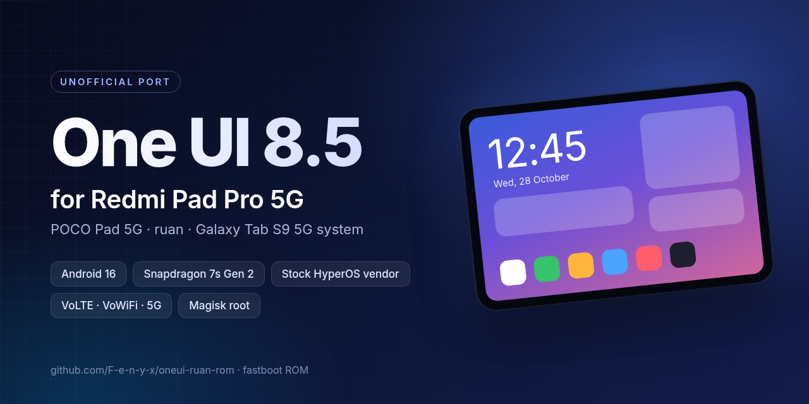
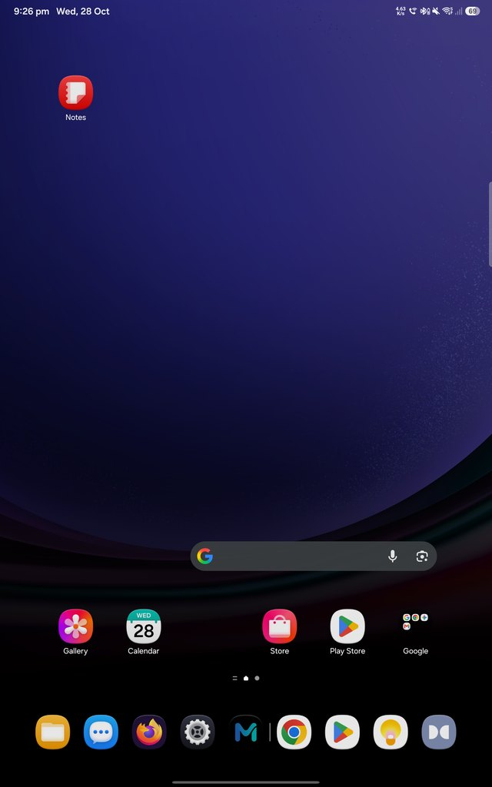
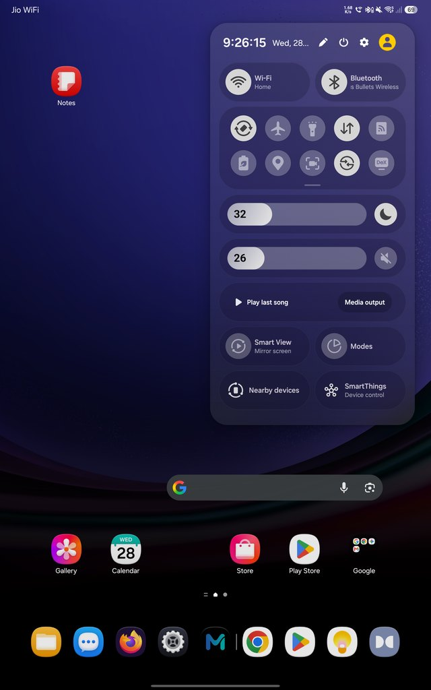
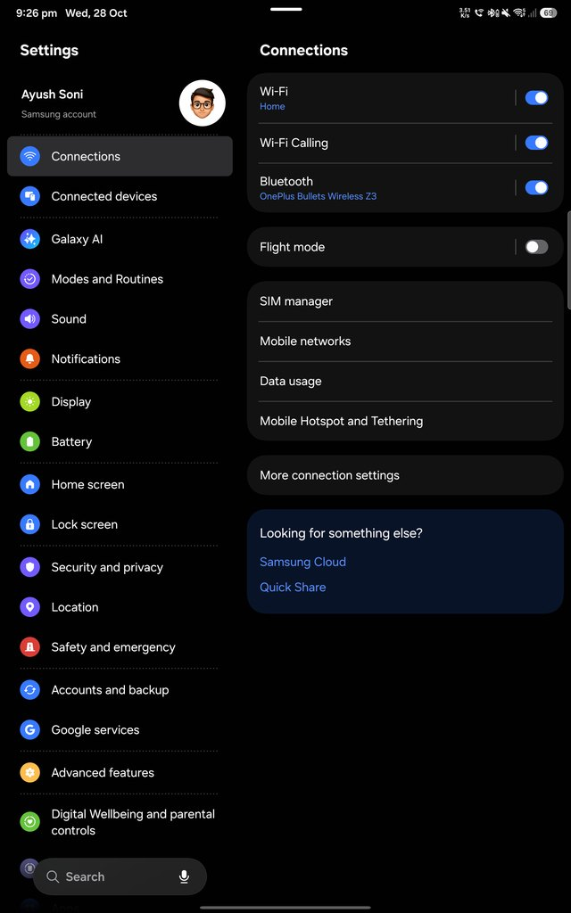
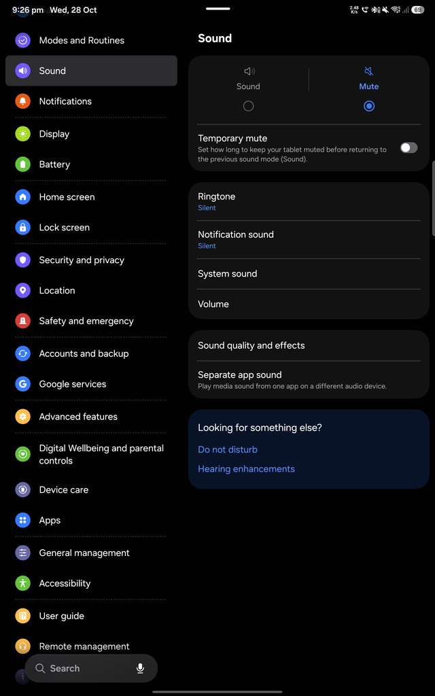
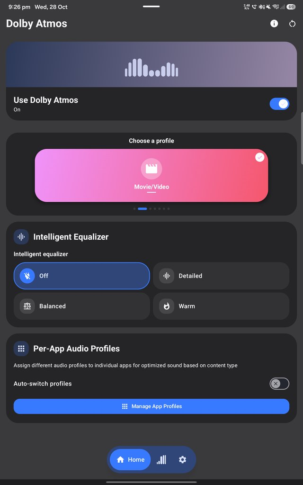
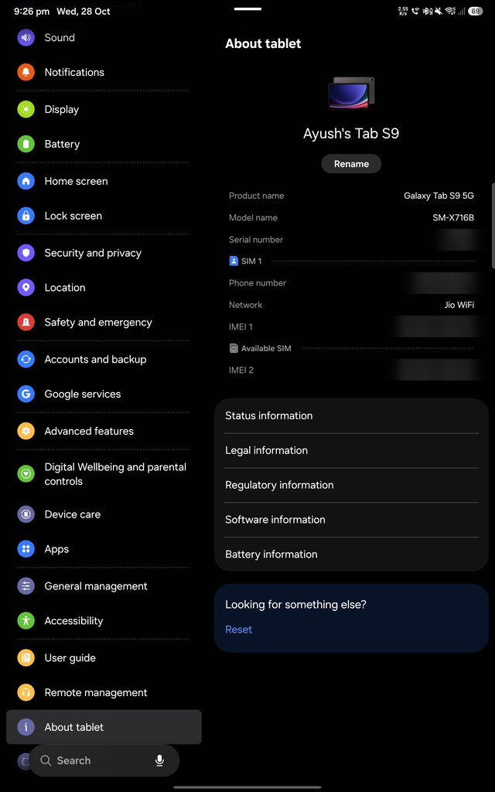

<div align="center">



# One UI 8.5 for Redmi Pad Pro 5G

**Samsung One UI 8.5 (Android 16) for the Redmi Pad Pro 5G / POCO Pad 5G (`ruan`): flashable fastboot ROM**

Galaxy Tab S9 5G system · stock HyperOS vendor · Magisk root · **v1.6-b30-20261028**

**[What works](#what-works)** · **[Screenshots](#screenshots)** · **[Install](#install)** · **[Update](#update-keeps-data)** · **[Troubleshooting](#troubleshooting)**

</div>

---

## What works

<table>
<tr><th>✅ Works</th><th>⚠️ Doesn't work / limited</th></tr>
<tr><td valign="top">

- SIM, 4G/5G data, dual SIM
- **Calls on VoLTE and Wi-Fi calling**, SMS in and out
- Wi-Fi (fast roaming), hotspot 2.4 / 5 GHz
- Bluetooth audio with headset battery in the status bar
- Speakers, mic, **Dolby Atmos** app
- 120 Hz while touching, 60 Hz idle; 33 W fast charging
- Samsung account, Galaxy Store, **Quick Share**
- **Storage share** and **Second screen** with a Galaxy phone / PC
- Theme Center, Good Lock, Routines, Edge panels
- **Root** (Magisk 30.7, preinstalled)

</td><td valign="top">

- Cameras and S Pen (removed: need Samsung hardware)
- Bixby, Samsung Pass, Secure Folder, Knox
- aptX / LDAC (Bluetooth is AAC / SBC)
- Protected video on Second screen
- Contacts stored on the SIM card are not shown
- Samsung's Wi-Fi Calling screen may say "registering" (calling itself works)
- Cellular signal a little weaker than on a Galaxy

</td></tr>
</table>

## Screenshots

<div align="center">
<table>
<tr><td align="center"><br><sub>Home screen</sub></td><td align="center"><br><sub>Quick panel</sub></td><td align="center"><br><sub>Settings: Wi-Fi Calling on</sub></td></tr>
<tr><td align="center"><br><sub>Sound</sub></td><td align="center"><br><sub>Dolby Atmos</sub></td><td align="center"><br><sub>About: shows as Galaxy Tab S9 5G</sub></td></tr>
</table>
<sub>Phone number, IMEI and serial number blurred.</sub>
</div>

## Install

> [!WARNING]
> Needs an **unlocked bootloader**. The first install **erases all data**: back up first.
> **Never re-lock the bootloader** on this ROM.

**You need:** the tablet with an unlocked bootloader and the battery above 50%, a USB-C data cable, and a PC.
Windows: Xiaomi or Google USB driver. Linux / macOS: Android platform-tools (`fastboot`) in PATH.

1. Download the ROM (about 7 GB):
   ```
   git clone --depth 1 https://github.com/F-e-n-y-x/oneui-ruan-rom.git
   ```
   Large images are stored in 95 MB parts. The install/update scripts join and sha256-check them the first time you run them.
2. Power off the tablet, then hold **Volume Down + Power** until **FASTBOOT** shows. Connect it to the PC.
3. In the `oneui-ruan-rom` folder, run **`install.bat`** (Windows) or **`./install.sh`** (Linux / macOS) and type `YES`.
4. The tablet reboots by itself. The first boot takes up to 10 minutes; about 2 minutes later apps are optimised in the background.
5. Open the **Magisk** app once and let it finish its setup.

## Update (keeps data)

1. Get the new release: `git fetch --depth 1 && git reset --hard origin/main` in the folder (or clone again).
2. Boot to **FASTBOOT** as above and run **`update.bat`** or **`./update.sh`**.

Only the latest release is kept in this repository.

## Troubleshooting

| Problem | Fix |
|---|---|
| `Missmatching image and device` | This ROM is only for `ruan` (Redmi Pad Pro 5G / POCO Pad 5G). The Wi-Fi model (`dizi`) is not supported. |
| `A joined image is corrupt` | Delete the image named in the message from `images/` (not its `.partNNN` files) and run the script again. If it repeats, clone again. |
| `waiting for any device` | Install the USB driver (Windows), try another cable/port, check `fastboot devices`. |
| Stuck on the boot logo for more than 15 min | Run `install` again (erases data). Back to HyperOS: flash the stock HyperOS fastboot ROM with its `flash_all` script. |

## Details

| | |
|---|---|
| Device | Redmi Pad Pro 5G / POCO Pad 5G (`ruan`, 24074RPD2G) |
| Base system | Galaxy Tab S9 5G SM-X716B, One UI 8.5 (`X716BXXS6EZI2`) |
| Vendor | Stock HyperOS OS3.0.305.0 (India), unmodified |
| Kernel | Caramel 5.10, Magisk 30.7 patched in |
| SELinux | Enforcing |

The installer flashes the stock HyperOS OS3.0.305.0 firmware, the One UI `super` image, the kernel and `vbmeta` with
verification disabled (the bootloader stays unlocked), then reboots. All flashing happens in bootloader fastboot.

## Disclaimer

Unofficial community project, not affiliated with Samsung or Xiaomi. Flashing custom firmware can void your warranty and
may brick your device: you do this at your own risk. Samsung and Xiaomi software remain the property of their owners.
