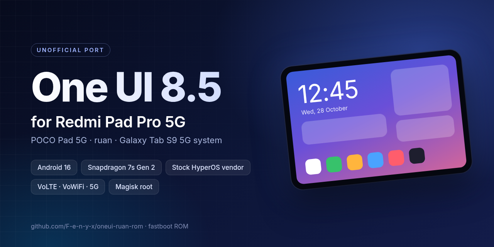
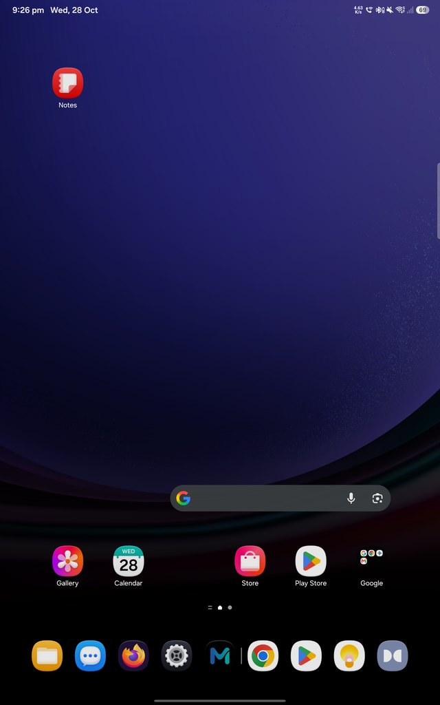
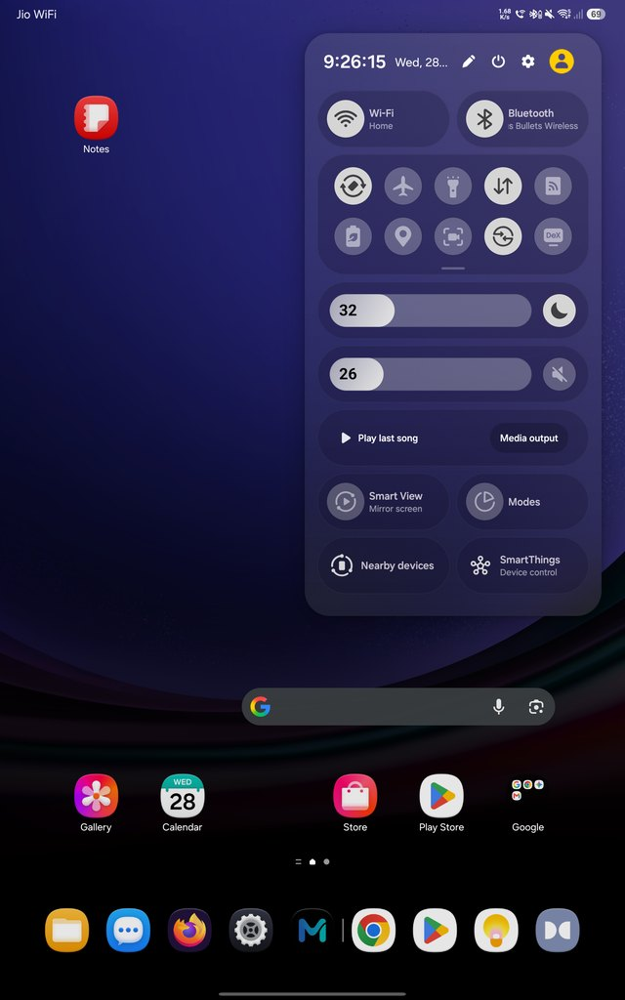
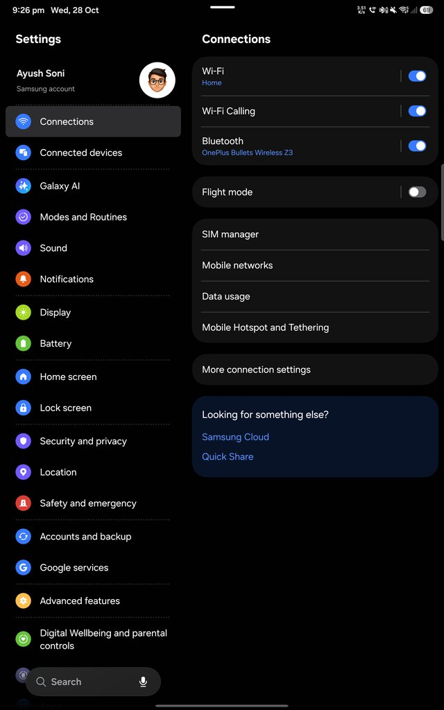
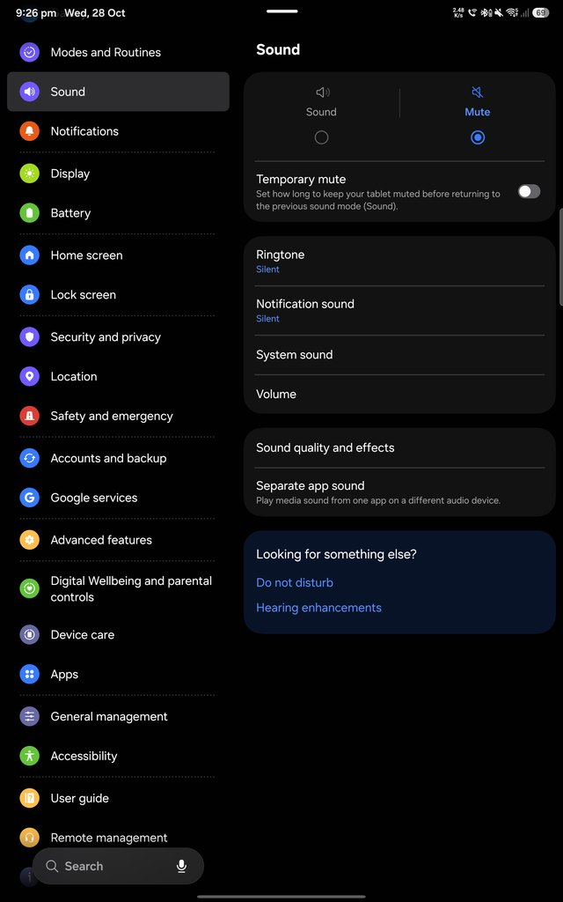
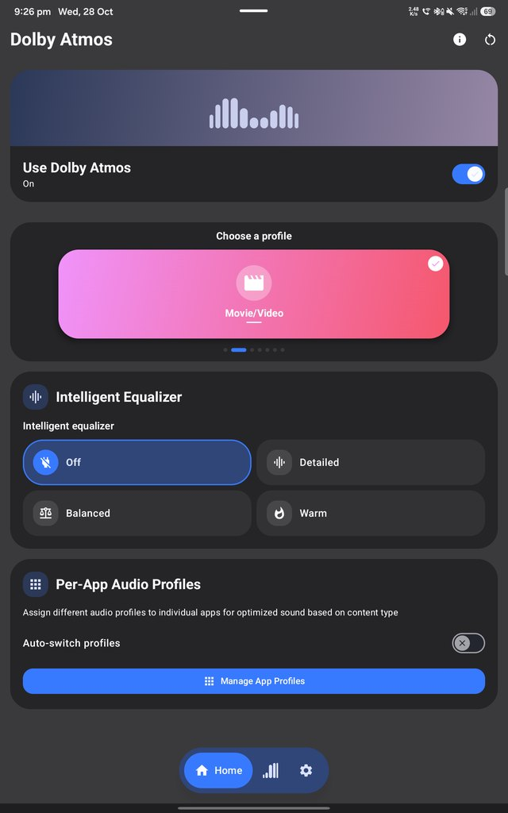
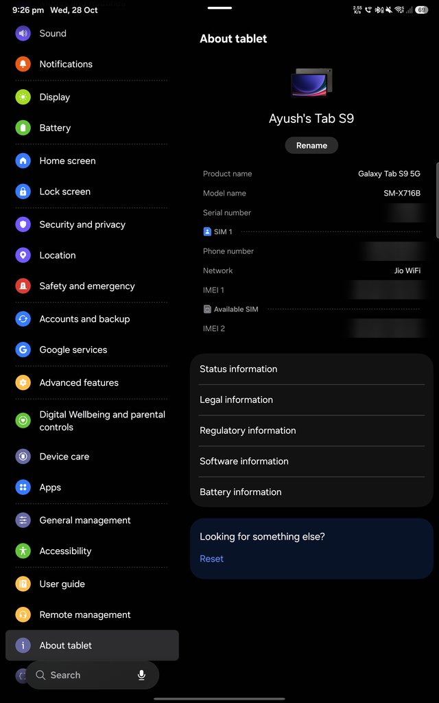
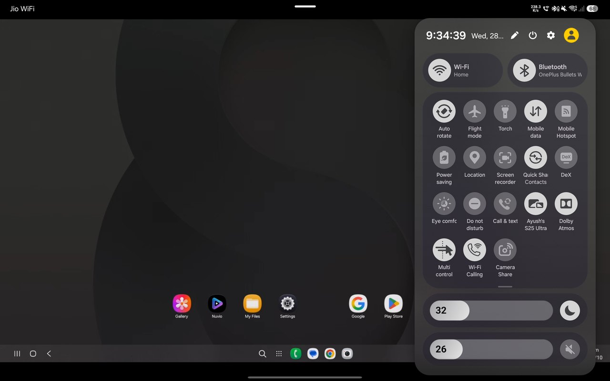

# One UI 8.5 for Redmi Pad Pro 5G

**Samsung One UI 8.5 (Android 16) for the Redmi Pad Pro 5G / POCO Pad 5G (`ruan`): flashable fastboot ROM**

Galaxy Tab S9 5G system · stock HyperOS vendor · Magisk root · **v2.2-b37-20261108**

**[What works](#what-works)** · **[Screenshots](#screenshots)** · **[Install](#install)** · **[Update](#update-keeps-data)** · **[Troubleshooting](#troubleshooting)**

---

## What works

<table>
<tr><th>✅ Works</th><th>⚠️ Doesn't work / limited</th></tr>
<tr><td valign="top">

- SIM, 4G/5G data, dual SIM
- **Calls on VoLTE and Wi-Fi calling**, SMS in and out
- Wi-Fi (fast roaming), hotspot 2.4 / 5 GHz
- Bluetooth audio with headset battery in the status bar
- Speakers, mic, **Dolby Atmos** app
- 120 Hz while touching, 60 Hz idle; 33 W fast charging
- Samsung account, Galaxy Store, **Quick Share**
- **Storage share** and **Second screen** with a Galaxy phone / PC
- Theme Center, Good Lock, Routines, Edge panels
- **Face unlock** (front camera)
- Bluetooth AAC; LDAC and aptX encoders included
- **Root** (Magisk 30.7, preinstalled)
- **Updates over the air** in Settings > Ruan Fixes (from v2.2-b37 on)

</td><td valign="top">

- Samsung Camera and S Pen (removed: need Samsung hardware). The cameras work in other camera apps
- Face unlock is camera-only (weak: not for banking apps); the setup preview stays black
- Bixby, Samsung Pass, Secure Folder, Knox
- Protected video on Second screen
- Contacts stored on the SIM card are not shown

</td></tr>
</table>

## Screenshots

<table>
<tr><td align="center"> Home screen</td><td align="center"> Quick panel</td><td align="center"> Settings: Wi-Fi Calling on</td></tr>
<tr><td align="center"> Sound</td><td align="center"> Dolby Atmos</td><td align="center"> About: shows as Galaxy Tab S9 5G</td></tr>
<tr><td align="center" colspan="3"> Second screen: a Galaxy S25 Ultra's wireless DeX desktop on the tablet</td></tr>
</table>
Phone number, IMEI and serial number blurred.

## Install

> [!WARNING]
> Needs an **unlocked bootloader**. The first install **erases all data**: back up first.
> **Never re-lock the bootloader** on this ROM.

**You need:** the tablet with an unlocked bootloader and the battery above 50%, a USB-C data cable, a PC with about
13 GB free, and [7-Zip](https://www.7-zip.org). Windows: Xiaomi or Google USB driver. Linux / macOS: Android
platform-tools (`fastboot`) in PATH, and `7z` (p7zip / 7zip package; Homebrew `sevenzip`).

1. Get this repository: `git clone https://github.com/F-e-n-y-x/oneui-ruan-rom` (or **Code > Download ZIP** and unzip it).
2. Power off the tablet, then hold **Volume Down + Power** until **FASTBOOT** shows. Connect it to the PC.
3. In the repository folder, run **`install.bat`** (Windows) or **`./install.sh`** (Linux / macOS). It downloads the
   release named in `release.txt` (about 5 GB; an interrupted download resumes when you run it again), checks its
   SHA-256, unpacks it into `download/` and starts the flasher. Type `YES` when asked.
4. The tablet reboots by itself. The first boot takes up to 10 minutes; about 2 minutes later apps are optimised in the background.
5. Open the **Magisk** app once and let it finish its setup.

Prefer one file? Download the full ROM as a single zip from
**[SourceForge](https://sourceforge.net/projects/oneui-port-redmi-pad-pro-5g/files/OneUI8.5-ruan-v2.2-b37-20261108.zip/download)**
(5.7 GB, SHA-256 `2824b076b9020d883b108a32f80c0fe20f2d13499049553073ea7932b72d6c60`), extract it and run
`install.bat` / `./install.sh` inside the extracted folder. No git needed.

Or get every `OneUI8.5-ruan-*.7z.00N` part of the
**[latest release](https://github.com/F-e-n-y-x/oneui-ruan-rom/releases/latest)**, open the `.7z.001` file with 7-Zip and
run `install.bat` / `./install.sh` inside the extracted folder.

## Update (keeps data)

- **On the tablet (v2.2-b37 and later):** Settings > **Ruan Fixes** offers new builds. It downloads the signed update
  and installs it in the background (seamless A/B update); restart when it says so.
- **From a PC (any earlier version):** `git pull` (or download the ZIP again), boot to **FASTBOOT** and run
  **`update.bat`** or **`./update.sh`**: same download and checks as install, but keeps your data.

## Troubleshooting

| Problem | Fix |
|---|---|
| `Missmatching image and device` | This ROM is only for `ruan` (Redmi Pad Pro 5G / POCO Pad 5G). The Wi-Fi model (`dizi`) is not supported. |
| 7-Zip reports a CRC / data error | One part did not download completely: download that `.7z.00N` part again. |
| `waiting for any device` | Install the USB driver (Windows), try another cable/port, check `fastboot devices`. |
| Stuck on the boot logo for more than 15 min | Run `install` again (erases data). Back to HyperOS: flash the stock HyperOS fastboot ROM with its `flash_all` script. |

## Details

| | |
|---|---|
| Device | Redmi Pad Pro 5G / POCO Pad 5G (`ruan`, 24074RPD2G) |
| Base system | Galaxy Tab S9 5G SM-X716B, One UI 8.5 (`X716BXXS6EZI2`) |
| Vendor | Stock HyperOS OS3.0.305.0 (India), unmodified |
| Kernel | Caramel 5.10, Magisk 30.7 patched in |
| SELinux | Enforcing |

The installer flashes the stock HyperOS OS3.0.305.0 firmware, the One UI `super` image, the kernel and `vbmeta` with
verification disabled (the bootloader stays unlocked), then reboots. All flashing happens in bootloader fastboot.

## Source code

Open-source parts of the ROM and where their source is:

| Part | License | Source |
|---|---|---|
| Kernel: Caramel 5.10 | GPL-2.0 | [noble6/kernel_xiaomi_ruan_caramel](https://github.com/noble6/kernel_xiaomi_ruan_caramel) |
| `md4.ko`, `cifs.ko` (storage share) | GPL-2.0 | Android Common Kernel android12-5.10 @ [`e1a4a0f26`](https://android.googlesource.com/kernel/common/+/e1a4a0f26), `gki_defconfig`, `CONFIG_CIFS=m`, `CONFIG_CRYPTO_MD4=m` |
| `ksmbd.ko` (SMB server) | GPL-2.0 | [namjaejeon/ksmbd @ `bbe4cb2`](https://github.com/namjaejeon/ksmbd/tree/bbe4cb2), built against the tree above |
| Magisk 30.7 | GPL-3.0 | [topjohnwu/Magisk v30.7](https://github.com/topjohnwu/Magisk/tree/v30.7) |

The install and update scripts in this repository are MIT-licensed ([LICENSE](LICENSE)).

## Disclaimer

Unofficial community project, not affiliated with Samsung or Xiaomi. Flashing custom firmware can void your warranty and
may brick your device: you do this at your own risk. Samsung and Xiaomi software remain the property of their owners.
